## About

I'm **Pranesh S**, a Software Development Team Lead focused on building secure, scalable and intelligent software. My work spans **Cybersecurity, AI/ML, Blockchain, Cloud Computing and Full-Stack Engineering**.

I enjoy turning complex requirements into production-ready applications, leading engineering teams, and bringing security, automation and performance into the development lifecycle.

## Core expertise

- **Software engineering:** React, Next.js, Node.js, Python, Java, REST APIs and microservices
- **Cybersecurity:** Secure SDLC, vulnerability assessment, digital forensics, OWASP and MITRE ATT&CK
- **AI & automation:** Machine learning, computer vision, GenAI and workflow automation
- **Blockchain:** Ethereum, Solidity, smart contracts, Web3, DID and SSI
- **Cloud & DevOps:** AWS, Docker, Kubernetes, CI/CD, Git and Firebase

## Connect

- [Portfolio](https://async-2.vercel.app/)
- [LinkedIn](https://www.linkedin.com/in/pranesh-s-ps34101136/)
- [GitHub](https://github.com/pranesh-fortumars)
- [Email](mailto:praneshs616@gmail.com)

---

Animated SVG cards are generated by scripts/render_profile_cards.py. Contribution data is refreshed daily by GitHub Actions. For a still screenshot preview, run STATIC=1 python scripts/render_profile_cards.py.
